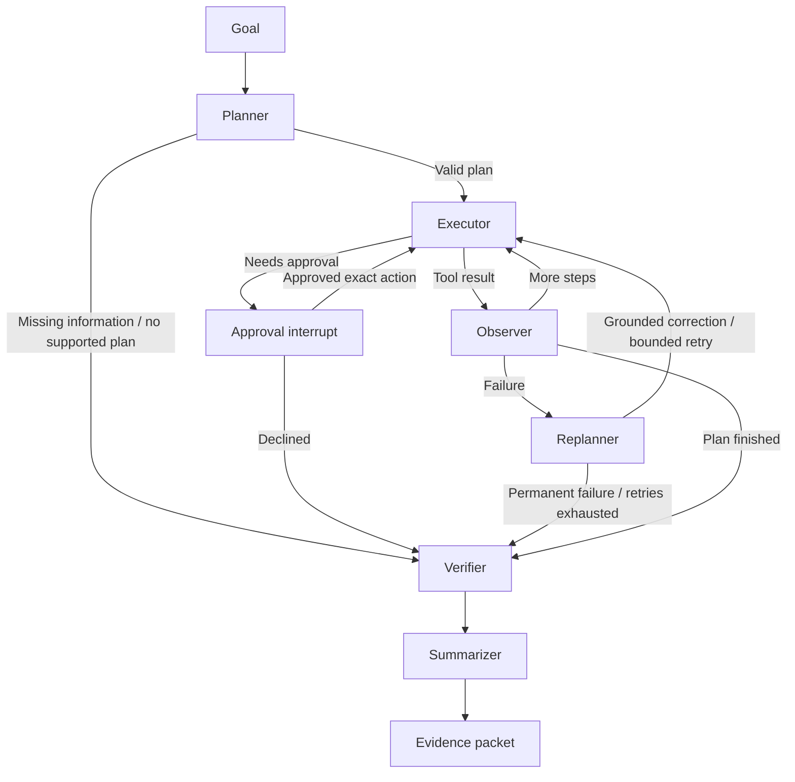

# Operon architecture

The system implements the internship problem statement inside a bounded company sandbox. It processes invoices and vendor profiles, retrieves quotations from signed deal sources, searches company records, mutates a simulated ERP when requested, and verifies outcomes independently. The graph and interfaces are shared across these workflows.

## Execution graph

`operon/graph.py` assembles the graph. Each `OperonAgent` owns its checkpointer, configuration, and ERP binding. Context variables bind tools and verification to that same ERP while a graph segment executes. The dashboard serializes tasks; context isolation also allows a preview agent to use a cloned ledger without touching the shared environment.

## State and tool boundaries

`OperonState` contains the goal, typed plan, current step, scratchpad, action/error history, retries, verification, policy decisions, start snapshot, execution mode, and evidence packet. Pydantic models describe plan steps and records. The in-memory checkpoint serializer explicitly allows those models.

`planner.py` validates step shape, order, tool membership, and a 12-step limit. Model JSON that cannot form a supported plan falls back to `workflows.py`, which derives its plan from the user's task and available company data. Unsupported goals receive a clarification error and proceed to a failed verification report.

The planner exposes local document tools and supported ERP tools. Legacy browser simulations, arbitrary API requests, file writes, and deletion are excluded from planning. Preview applies an additional allowlist before dispatch, so non-sandbox tools cannot write files or call external services through that execution path. File tools independently confine reads to company sample data and run storage, and writes to run storage or the operating-system temporary directory.

The observer preserves source expectations separately from mutable entities. An invoice creation response cannot overwrite the source amount used by the independent audit. Vendor profiles similarly retain name, tax ID, terms, and contact details.

## Approval lifecycle

Policy checks happen after argument interpolation, when the executor knows the actual resource and values. `data_policy.py` assigns `PUBLIC`, `INTERNAL`, `CONFIDENTIAL`, or `RESTRICTED` using explicit directory rules, action semantics, and conservative filename hints. Vendor profiles are restricted because they contain tax identifiers and contact details. Invoice, deal, quotation, and blueprint sources are confidential. The classification, categories, policy ID, and decision are retained in evidence. Source records also carry their classification.

Restricted reads require approval in previews and executions because preview isolation protects ledger writes, not information access. Real vendor registration, persistent file writes, form submissions, mutating API calls, and financial entries above $25,000 require execution approval. API calls with credential-bearing headers require approval in every mode. Approval-display arguments redact secrets, bodies, full tax identifiers, and email local parts; the graph retains the original values internally for execution and fingerprinting.

The gate uses LangGraph's [documented interrupt/resume mechanism](https://docs.langchain.com/oss/python/langgraph/interrupts). It exposes the resolved action and pauses. Approval is tied to a SHA-256 fingerprint of the policy version, step ID, tool, and original arguments. A decision authorizes only that exact invocation; a later action is evaluated again. The evidence records `approved`, `declined`, or `would_require_on_execution`. Declining routes to verification without executing the pending operation.

The dashboard validates the pending run, fingerprint, and strict boolean decision. Stale and duplicate decisions are rejected. CLI decisions use the same graph; EOF declines the operation.

Preview executes write-gated actions only inside its copy and records that execution approval would be required. It still interrupts before restricted data access.

## Recovery and verification

Recovery can normalize a valid monetary string, extract a valid ISO date embedded in prose, use a previously discovered vendor ID, or retry a failed file search in the known sample directory. It never guesses a default vendor or generates a substitute invoice ID. Permanent conflicts stop dependent steps; unexpected failures have a retry cap.

Verification reads the current ERP directly. It checks source hashes, presence, amount, due date, vendor association, and completion of planned steps. Vendor onboarding checks all source profile fields and active status. A no-op tool history is not sufficient proof of success.

`company_tools.py` adds three read-only tools: `find_latest_signed_deal`, `read_deal_quotation`, and `search_company_records`. Deal selection uses source signing dates and returns a catalogue manifest. Quote lookup follows the selected deal's explicit link and constrains it to the company quotation folder. `company_verification.py` independently rereads the catalogue and quotation, checks current selection against the manifest, excludes unsigned deals, and compares the IDs, customer, amount, and currency. A changed catalogue or mismatched quote fails verification. Cross-source search captures text excerpts, file hashes, and ERP record snapshots, which verification checks against current sources and ledger data.

An empty required search is an unresolved outcome, not success. It stops dependent actions unless the next step is an explicit alternate search. A later successful search clears the empty-result flag. Permanent missing files, ambiguous deals, and invalid company sources stop without repeated attempts at the same action.

The summarizer determines `completed`, `partially_completed`, or `failed` from verification and new records. It compares the ERP with the run's own baseline, includes errors and policy checks, and generates a factual narrative from the actual records.

`outcomes.py` creates a typed `TaskIssue` with a reason code, user-facing title, explanation, and next step. This distinguishes missing resources, clarification, unsupported work, declined actions, invalid source data, conflicts, tool errors, and verification failures. The conversational response explains changes that already occurred; technical diagnostics remain in the evidence. A source that was never searched is never described as nonexistent. Send `try again` after a failed run to resubmit that same goal and mode through the ordinary execution and approval path.

## Web execution and persistence

`operon/runs.py` owns a single background worker and SQLite history. `ui/app.py` provides:

| Endpoint | Purpose |
| --- | --- |
| `POST /api/chat` | Reply to a task follow-up, start a goal, or decide the context run's pending approval |
| `POST /api/runs` | Validate a goal and start one task; returns a run ID |
| `GET /api/runs` | Recent run metadata |
| `DELETE /api/runs` | Clear saved reports and events when no task is active |
| `GET /api/runs/{id}` | Status, pending approval, and final report |
| `GET /api/runs/{id}/events` | Stream incremental saved events; resume from `Last-Event-ID` |
| `POST /api/runs/{id}/approval` | Approve or decline the pending exact action |
| `GET /api/runs/{id}/evidence` | Download JSON evidence |
| `GET /api/runs/{id}/sources/{index}` | Open a captured sandbox source only if its current hash still matches the report |
| `POST /api/run` | Synchronous compatibility endpoint; returns 202 if approval is pending |
| `GET /api/erp/state` | Current company ledger and vendor directory |
| `POST /api/erp/reset` | Reset seeded ERP data when no task is active |

SSE only observes a previously created run. It never creates work on a reconnect. Node events are serialized immediately after each transition, before later nodes run. Terminal status and its final event are committed in one SQLite transaction.

`operon/conversation.py` routes simple conversational messages before task execution. Greetings need no tools. Supported follow-up questions read the context run's saved evidence packet rather than the current ledger or a new model response. A request to execute a preview requires a verified preview and resubmits its original goal through the existing run manager. Chat approval uses the pending action's existing fingerprint; preview messages cannot authorize an actual run. New goals still use the existing planner and graph.

Reports and events persist under `storage/`; ERP records and graph checkpoints remain in memory. At startup, unfinished saved runs become `interrupted`, with an explanation that their checkpoints cannot resume. Completed reports remain readable until the user deliberately clears history. Deletion is blocked while a task or approval is active and does not reset the ERP.

## Evidence format

Each packet contains the goal, run ID, mode, planner backend, plan, source file hashes, action log, errors and recovery attempts, policy checks, verification details, a structured issue when unsuccessful, created records, per-run state differences, duration, and `evidence_sha256`. Quotation selection manifests and search matches are captured in the action observations.

The digest is SHA-256 over UTF-8 JSON with sorted keys, compact separators, `ensure_ascii=False`, and the digest field removed. `evidence_digest()` recomputes it. The checksum supports comparison with an independently retained report; it provides no signer identity or protection against an attacker replacing both content and digest.

## UI decisions

The dashboard prioritizes the user's goal, activity, decision requests, verification, and ledger. It uses neutral paper colors, restrained green accents, system fonts, and a simple sidebar. Technical details stay expanded so plans, action arguments, verification, evidence, and vendor records remain inspectable throughout a demo. Failed and preview outcomes have distinct labels. Dynamic document content uses text nodes instead of HTML interpolation. History remains accessible on a narrow screen through the Recent tasks toggle.

The conversation is the primary input surface. Its transcript has independent scrolling, a persistent composer, and a latest-message shortcut. Operon replies use a restrained response surface, while the scratchpad gives the checked outcome its own success or failure emphasis. Detailed activity and verification stay visible below. The latest 100 conversation messages and context run ID persist in browser local storage, while SQLite remains the source for run reports and events. **New conversation** clears browser context only; the confirmed **Clear history** action removes saved runs and the current conversation. Neither action resets the ERP.

## Validation and future work

Tests run offline against isolated fixtures and temporary SQLite stores. Coverage includes successful workflows, corrupt ledger data, source changes, wrong vendors, ambiguous company filename matches, invalid values, approval scope, preview isolation, early event delivery, reconnect replay, and server restart handling.

The next architectural step is a durable ledger and checkpointer designed together. That would let an interrupted run resume against the same business state. A future conversational clarification flow should preserve the current plan and ask only for the missing information. Both are more relevant to this prototype than adding unrelated connectors or multiple agents.
