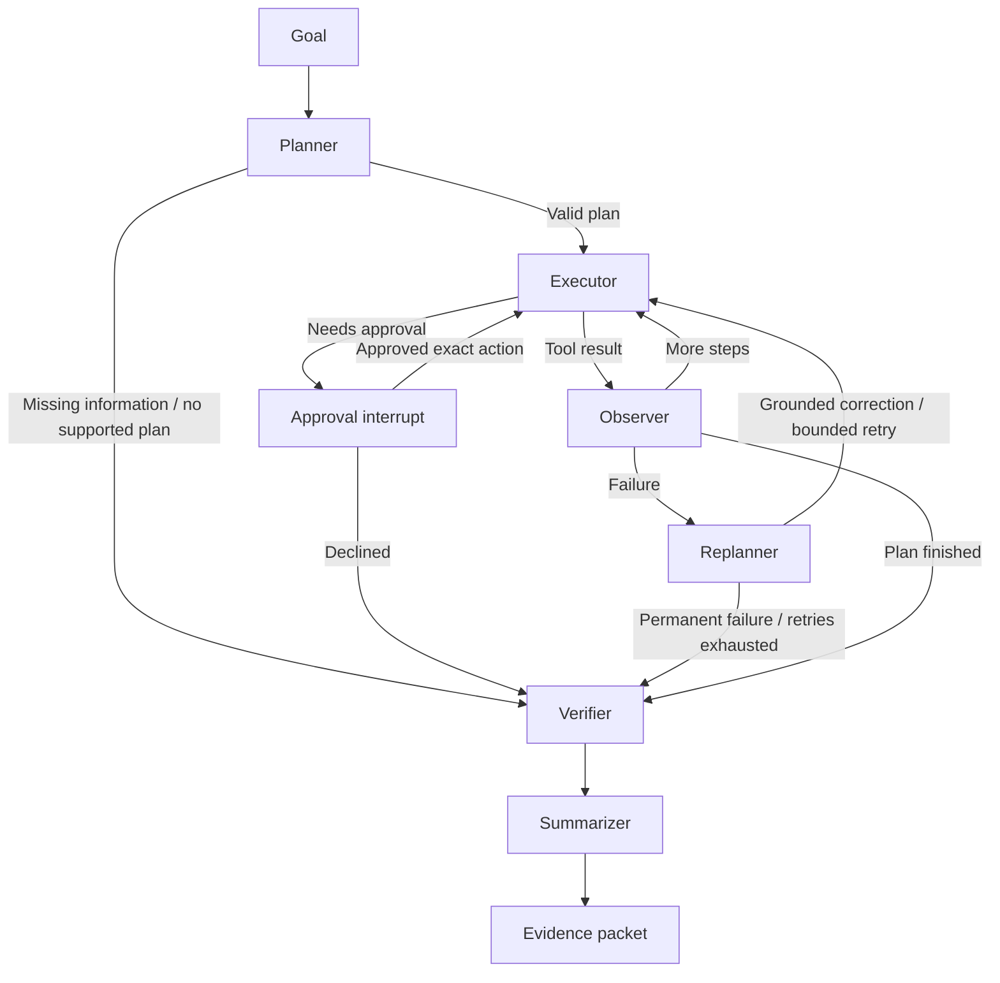

# Operon architecture

The system implements the internship problem statement inside a bounded company sandbox. It processes invoices and vendor profiles stored as local files, mutates a simulated ERP, and verifies outcomes independently. The graph and interfaces are shared across both workflows.

## Execution graph

`operon/graph.py` assembles the graph. Each `OperonAgent` owns its checkpointer, configuration, and ERP binding. Context variables bind tools and verification to that same ERP while a graph segment executes. The dashboard serializes tasks; context isolation also allows a preview agent to use a cloned ledger without touching the shared environment.

## State and tool boundaries

`OperonState` contains the goal, typed plan, current step, scratchpad, action/error history, retries, verification, policy decisions, start snapshot, execution mode, and evidence packet. Pydantic models describe plan steps and records. The in-memory checkpoint serializer explicitly allows those models.

`planner.py` validates step shape, order, tool membership, and a 12-step limit. Model JSON that cannot form a supported plan falls back to `workflows.py`, which derives its plan from the user's task and available company data. Unsupported goals receive a clarification error and proceed to a failed verification report.

The planner exposes local document tools and supported ERP tools. Legacy browser simulations, arbitrary API requests, file writes, and deletion are excluded from planning. Preview applies an additional allowlist before dispatch, so non-sandbox tools cannot write files or call external services through that execution path. Preview is ERP isolation, not an operating-system sandbox.

The observer preserves source expectations separately from mutable entities. An invoice creation response cannot overwrite the source amount used by the independent audit. Vendor profiles similarly retain name, tax ID, terms, and contact details.

## Approval lifecycle

Policy checks happen after argument interpolation. Monetary parsing is shared with execution so a formatted amount such as `$48,500.00` receives the same threshold check as `48500`.

The gate uses LangGraph's [documented interrupt/resume mechanism](https://docs.langchain.com/oss/python/langgraph/interrupts). It exposes the resolved action and pauses. Approval is tied to a SHA-256 fingerprint of the step ID, tool, and arguments. A decision authorizes only that exact invocation; a later action is evaluated again. Declining routes to verification without executing the pending operation.

The dashboard validates the pending run, fingerprint, and strict boolean decision. Stale and duplicate decisions are rejected. CLI decisions use the same graph; EOF declines the operation.

Preview executes the gated action only inside its copy, recording that approval would be required for an actual run.

## Recovery and verification

Recovery can normalize a valid monetary string, extract a valid ISO date embedded in prose, use a previously discovered vendor ID, or retry a failed file search in the known sample directory. It never guesses a default vendor or generates a substitute invoice ID. Permanent conflicts stop dependent steps; unexpected failures have a retry cap.

Verification reads the current ERP directly. It checks source hashes, presence, amount, due date, vendor association, and completion of planned steps. Vendor onboarding checks all source profile fields and active status. A no-op tool history is not sufficient proof of success.

The summarizer determines `completed`, `partially_completed`, or `failed` from verification and new records. It compares the ERP with the run's own baseline, includes errors and policy checks, and generates a factual narrative from the actual records.

## Web execution and persistence

`operon/runs.py` owns a single background worker and SQLite history. `ui/app.py` provides:

| Endpoint | Purpose |
| --- | --- |
| `POST /api/runs` | Validate a goal and start one task; returns a run ID |
| `GET /api/runs` | Recent run metadata |
| `GET /api/runs/{id}` | Status, pending approval, and final report |
| `GET /api/runs/{id}/events` | Stream incremental saved events; resume from `Last-Event-ID` |
| `POST /api/runs/{id}/approval` | Approve or decline the pending exact action |
| `GET /api/runs/{id}/evidence` | Download JSON evidence |
| `POST /api/run` | Synchronous compatibility endpoint; returns 202 if approval is pending |
| `GET /api/erp/state` | Current company ledger and vendor directory |
| `POST /api/erp/reset` | Reset seeded ERP data when no task is active |

SSE only observes a previously created run. It never creates work on a reconnect. Node events are serialized immediately after each transition, before later nodes run. Terminal status and its final event are committed in one SQLite transaction.

Reports and events persist under `storage/`; ERP records and graph checkpoints remain in memory. At startup, unfinished saved runs become `interrupted`, with an explanation that their checkpoints cannot resume. Completed reports remain readable.

## Evidence format

Each packet contains the goal, run ID, mode, planner backend, plan, source file hashes, action log, errors and recovery attempts, policy checks, verification details, created records, per-run state differences, duration, and `evidence_sha256`.

The digest is SHA-256 over UTF-8 JSON with sorted keys, compact separators, `ensure_ascii=False`, and the digest field removed. `evidence_digest()` recomputes it. The checksum supports comparison with an independently retained report; it provides no signer identity or protection against an attacker replacing both content and digest.

## UI decisions

The dashboard prioritizes the user's goal, activity, decision requests, verification, and ledger. It uses neutral paper colors, restrained green accents, system fonts, a simple sidebar, and expandable technical details. Failed and preview outcomes have distinct labels. Dynamic document content uses text nodes instead of HTML interpolation. History remains accessible on a narrow screen through the Recent tasks toggle.

## Validation and future work

Tests run offline against isolated fixtures and temporary SQLite stores. Coverage includes successful workflows, corrupt ledger data, source changes, wrong vendors, ambiguous company filename matches, invalid values, approval scope, preview isolation, early event delivery, reconnect replay, and server restart handling.

The next architectural step is a durable ledger and checkpointer designed together. That would let an interrupted run resume against the same business state. A future conversational clarification flow should preserve the current plan and ask only for the missing information. Both are more relevant to this prototype than adding unrelated connectors or multiple agents.
