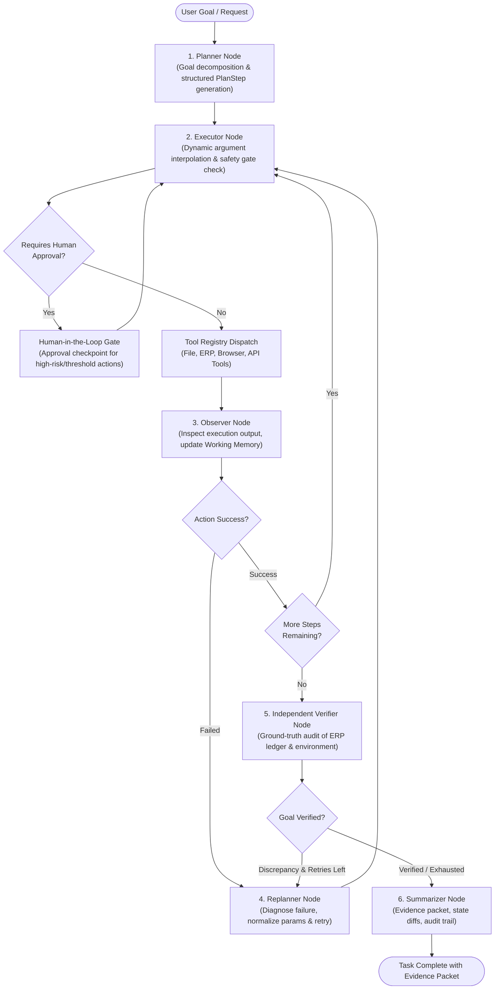

# Operon — System Architecture & Design Specification

Operon is an **Autonomous AI Task Worker** engineered for enterprise workflow automation. Unlike traditional brittle RPA scripts or passive LLM chatbots, Operon is a **stateful, cognitive computational graph** built on **LangGraph**, **LangChain**, and **Groq's LPU inference engine (running Alibaba Qwen 3.8 27B)**.

---

## 1. High-Level Architectural Diagram



---

## 2. Core State Machine (`OperonState`)

Operon tracks execution using a centralized state schema defined in `operon/state.py`:

```python
class OperonState(TypedDict):
    task: str                          # Original high-level natural language request
    plan: List[PlanStep]               # Discrete, structured steps to achieve the goal
    current_step_index: int            # Pointer to active step in plan
    scratchpad: Dict[str, Any]         # Context working memory of discovered entities
    action_history: List[ActionRecord] # Immutable audit log of every tool call and observation
    errors: List[ErrorRecord]          # Categorized failure history and recovery strategies
    retry_count: Dict[str, int]        # Retries per step
    verification_result: Optional[VerificationResult] # Independent outcome proof
    evidence_packet: Optional[EvidencePacket]         # Auditable completion packet
    requires_approval: bool            # Safety pause flag
    approval_prompt: Optional[str]     # Context presented to human reviewer
    human_feedback: Optional[str]      # User response
    status: Literal["planning", "executing", "waiting_approval", "replanning", "verifying", "completed", "failed"]
    start_time: float                  # Epoch timestamp for execution timing
    last_execution_result: Optional[Dict[str, Any]] # Result from previous tool call
```

---

## 3. The 6 Cognitive Nodes

### Node 1: Planner (`operon/nodes/planner.py`)
- **Responsibility**: Interprets the user's high-level goal and infers prerequisite steps without requiring procedural instructions.
- **LLM Reasoning**: Invokes `ChatGroq(model="qwen/qwen3.8-27b", temperature=0.0)` with a strict JSON system prompt containing definitions of available tools.
- **Output**: Generates a typed sequence of `PlanStep(step_id, description, tool_name, tool_args, expected_outcome)`.

### Node 2: Executor (`operon/nodes/executor.py`)
- **Responsibility**: Coordinates step execution, enforces safety guardrails, and dynamically interpolates tool arguments.
- **Dynamic Variable Interpolation**: Replaces template variables (e.g., `{{step_1_result.file_path}}` or `{{scratchpad.vendor_id}}`) using facts stored in Working Memory (`Scratchpad`).
- **Safety Evaluation**: Evaluates proposed tool and arguments against `SafetyController`. If an operation is high-risk (e.g. record deletion, payment dispatch, or transactions > $25,000), it pauses execution for human review.

### Node 3: Observer (`operon/nodes/observer.py`)
- **Responsibility**: Inspects tool outcomes, extracts structured entities, and manages state transitions.
- **Working Memory Update**: When a tool returns data (e.g., invoice file search or vendor lookup), the observer extracts `invoice_number`, `amount`, `due_date`, and `vendor_id` into `Scratchpad.entities` and caches results under `Scratchpad.step_results[step_id]`.
- **Failure Routing**: If an exception occurred, categorizes the error (e.g., `ERPValidationError`, `VendorNotFoundError`) and routes to the Replanner.

### Node 4: Replanner (`operon/nodes/replanner.py`)
- **Responsibility**: Self-healing error recovery and adaptive replanning.
- **Recovery Strategies**:
  1. *Parameter Normalization*: When amounts are passed with currency symbols or commas (e.g. `"$13,446.00"`), cleans and casts to float `13446.00`.
  2. *Date Normalization*: When dates are passed in prose or unstructured strings, extracts ISO format (`YYYY-MM-DD`).
  3. *Query Broadening*: If exact vendor lookup fails, performs fuzzy alias matching.
  4. *Retry Cap*: If retries exceed threshold (`OPERON_MAX_RETRIES`), avoids infinite loops by escalating to human review or proceeding to verification.

### Node 5: Verifier (`operon/nodes/verifier.py`)
- **Responsibility**: **Independent outcome verification**. An autonomous agent cannot assume that executing actions implies the end goal was achieved.
- **Audit Methodology**: Independently queries the simulated ERP datastore or filesystem to verify ground truth:
  - Does the invoice actually exist in the ERP ledger?
  - Does the ledger amount match the source document ($13,446.00)?
  - Does the ledger due date match the source document (2026-04-10)?
  - Is the vendor ID correctly associated?
- **Output**: Returns `VerificationResult(is_verified=True/False, confidence_score=1.0, checks_performed=[...], evidence="...")`.

### Node 6: Summarizer (`operon/nodes/summarizer.py`)
- **Responsibility**: Formats the final auditable `EvidencePacket` for the user.
- **Packet Contents**:
  - Concise human-readable summary.
  - Verification outcome and confidence score.
  - Execution duration and action count.
  - Complete chronological action audit log.
  - Environmental state diffs (e.g., new records inserted into ERP).

---

## 4. Tool Registry & Simulated Enterprise Environment

To avoid brittle mocks, Operon implements a fully functional **in-memory transactional ERP system** (`operon/environment/erp_system.py`) with realistic business logic:

1. **Vendor Directory**: Pre-seeded with realistic vendor records (`Company X Solutions`, `Acme Logistics`, `Globex Software`). Supports name, ID, and alias lookup.
2. **Accounts Payable Ledger**: Enforces unique invoice numbers, foreign key checks on vendor IDs, positive numeric amounts, and ISO dates. Raises descriptive typed exceptions (`DuplicateInvoiceError`, `VendorNotFoundError`, `InvalidDateFormatError`).
3. **Audit Log & State Snapshots**: Records every transactional mutation. Computes exact state diffs (`compute_state_diff()`) before and after agent execution.
4. **Tool Ecosystem**:
   - `file_tools.py`: Search files, read text/JSON/PDF, extract structured invoice fields, sort files chronologically to find latest invoice.
   - `erp_tools.py`: Vendor lookup, invoice registration, ledger queries, independent status verification, destructive record deletion.
   - `browser_tools.py`: Simulated intranet portal navigation, form submission, and DOM inspection.
   - `api_tools.py`: REST HTTP client for webhooks and external service integration.

---

## 5. Technical & Design Decisions

| Decision | Rationale |
| :--- | :--- |
| **LangGraph StateGraph** | Provides cyclical execution graphs, state checkpointing (`MemorySaver`), native interrupt capabilities, and observable edge transitions. |
| **Groq API + Qwen 3.8 27B** | Delivers ultra-low latency inference on Groq LPUs with dense 27B reasoning capabilities, strong structured output generation, and native tool-calling proficiency. |
| **Resilient Simulation Fallback** | Allows the entire test suite and CLI/demos to run offline or in CI/CD without hard external API dependencies, guaranteeing reproducibility. Automatically engages live Groq whenever `GROQ_API_KEY` is present. |
| **Independent Verifier Node** | Separates the *execution agent* from the *auditor*. The verifier directly inspects environmental ground-truth rather than trusting the model's self-reported success. |
| **Self-Healing Replanner** | Prevents agent crashes from minor data mismatches (e.g., currency symbols, date formats) through programmatic normalization rules before re-trying. |
| **FastAPI + SSE Web Dashboard** | Exposes real-time streaming updates (`EventSource`) to a glassmorphic dashboard, visualizing graph nodes, working memory, and live ERP database state. |
