# Project review and implemented changes

Date: 21 October 2026. Scope: the supplied **Autonomous AI Task Worker** internship problem statement.

The goal was to improve a narrow working prototype: interpret a business goal, execute meaningful actions in a simulated company environment, recover from errors, request approval when needed, verify results, and return useful evidence. Invoice processing and vendor onboarding remain the demonstration workflows.

## Review findings

| Finding in the original project | Why it mattered | Implemented response |
| --- | --- | --- |
| The human gate automatically supplied `approved` | High-risk operations did not actually wait for a person | Real LangGraph interrupts, exact-action decisions, dashboard and CLI resume paths |
| SSE converted the entire agent stream to a list | Users saw progress only after all work finished | Persist each node event as it occurs and stream it incrementally |
| Several plans and tools defaulted to Company X fields | Different goals could execute the wrong business operation | Data-driven offline plans, resolved placeholders, required source fields |
| Summary text invented Company X invoice details even for vendor tasks | The report could misrepresent what happened | Summaries generated from actual verification and records |
| State differences compared with the initial application seed | A later report could include records created by an earlier task | Snapshot the ERP at the start of every run |
| Generic verification treated a nonempty action history as success | Failed or irrelevant actions could be reported as completion | Explicit supported outcome checks and fail-closed verification |
| Source expectations could be replaced by write-tool output | The auditor could compare a wrong record against the same wrong output | Preserve invoice/profile source data separately from mutable entities |
| Currency cleanup discarded negative signs; date checks accepted impossible dates | Invalid values could enter the ledger or evade policy interpretation | Shared strict monetary parsing and real calendar validation |
| Invoice selection used broad tokens and preferred filename matches | Company X could match Company Y; a newer content match could be ignored | Match source issuer identity and compare all matching document dates |
| API failures could turn into simulated HTTP 200 responses | A failed request could look successful | Preserve request failures and reject unsuccessful HTTP status codes |
| A deletion helper returned success without deleting anything | A tool advertised work it did not perform | Return an explicit unsupported-operation error; exclude it from planning |
| The UI emphasized engine branding, glowing nodes, badges, and dense panels | Users had to interpret implementation details to find the result | A calmer task workspace organized around work and evidence |

## Implemented behavior

### 1. Source-driven workflow generalization

- Company X, Acme, Globex, and OmniCorp use the same invoice workflow: find the latest source, resolve the vendor, enter the invoice, and check the record.
- Apex, Quantum, Horizon, and Cyberdyne use the same onboarding workflow: read the source profile, register it, and verify its fields and active status.
- The offline planner reads only the user's task when choosing a scenario. Tool descriptions in the system prompt no longer accidentally trigger vendor onboarding.
- Invalid model plans fall back to a bounded plan for the requested task. Unsupported goals produce a clarification explanation.
- Missing invoice IDs, tax IDs, vendor IDs, amounts, and dates are no longer replaced with invented business data.
- The simulated ERP enforces source invoice identity, positive finite monetary values, calendar dates, and vendor conflicts.
- Matching repeated entries are idempotent. Conflicting records remain visible as errors.

### 2. Genuine approval and bounded recovery

- Financial entries above $25,000 pause when approval checks are enabled, including formatted values such as `$48,500.00`.
- Approval is bound to the resolved step/tool/arguments fingerprint and consumed by that action.
- Declining prevents that action and stops dependent work. Duplicate or stale HTTP decisions are rejected.
- The CLI streams events as they happen and asks for a decision at the same checkpoint. A noninteractive EOF declines.
- Recovery uses validated transformations and facts already discovered. It no longer substitutes vendor `VND-001` after a failed lookup.
- Retry exhaustion and permanent conflicts stop downstream work before verification.
- The recovery demo now creates a temporary malformed invoice that actually fails ERP validation, gets repaired, retries, and passes the independent audit.

### 3. Preview changes

This extension makes autonomous execution reviewable. The same agent graph runs against an independent copy of the current ERP and produces a report of proposed records and balances.

- The shared ledger and its audit log are unchanged by preview execution.
- The report labels the mode as `preview` and records actions that would need approval during execution.
- Non-sandbox tools such as file writes and arbitrary API calls are blocked in the preview dispatcher.
- Preview does not automatically commit anything. Running the goal afterward creates a new execution against the current company ledger.
- The isolation applies to ERP writes; this is not a general-purpose operating-system sandbox.

### 4. Independent verification and evidence

- Source snapshots are retained separately from tool write responses.
- Verification checks document integrity, invoice presence, amount, due date, and vendor identity; onboarding checks the actual profile fields.
- An existing invoice under the wrong vendor fails verification even if its amount and date match.
- A source file changed during execution fails the integrity check.
- Agent runs without a captured invoice source cannot claim a source-verified invoice outcome.
- Reports count only the records created during that run, including new vendors and balance changes.
- A failure after an earlier successful write is reported as partial completion.
- Downloadable JSON includes source hashes, typed plans, action history, errors, recovery, policy checks, planner backend, and a SHA-256 report digest.
- The digest supports comparison with a retained original. It is not a signed or tamper-proof audit system.

### 5. Saved history and real progress

- `POST /api/runs` starts work once; the event endpoint only observes it.
- SQLite persists node events immediately, alongside task metadata and completed reports.
- SSE reconnects use event IDs and replay saved events instead of re-executing the task.
- The dashboard has one active task, so ledger changes and resets cannot race across dashboard runs.
- Restarting preserves reports, marks unfinished work interrupted, and explains that its in-memory checkpoint cannot resume.
- The ERP itself remains in memory. This limitation is explicit in the UI documentation and architecture.

## UI review and redesign

The intended feel is a small operations product, with clear typography and restrained visual treatment.

| Previous treatment | Current treatment |
| --- | --- |
| Dark glass panels and repeated badges | Neutral paper background, simple borders, and a single restrained accent |
| Giant model and framework labels | Task title, business scope, and a compact planner label in the footer |
| Animated cognitive pipeline as the main visual | A readable plan and activity list with progress states |
| Dense task preset chips | One example selector |
| Technical arguments always visible | Expandable action details |
| Working-memory object dump | Collected business facts and source documents |
| A numeric confidence meter without clear context | A verification outcome, performed checks, evidence, and discrepancy explanation |
| Always-successful completion banner | Separate completed, partial, failed, interrupted, and preview states |
| No decision workflow | An explicit approval panel showing the resolved arguments |
| No task history or downloadable evidence | Recent-task replay and an evidence download |
| External web font dependencies | System fonts; no frontend build step |

Additional details:

- A separate preview action explains that its ledger is isolated.
- The company ledger and vendor directory remain inspectable after execution.
- Dynamic text is inserted using DOM text nodes to avoid interpreting source content as HTML.
- Controls include labels, focus states, live status text, and disabled states during work.
- Narrow layouts stack the panels and expose history through the Recent tasks toggle.

## Files changed

| Area | Files |
| --- | --- |
| Agent lifecycle and graph | `operon/agent.py`, `operon/graph.py`, `operon/state.py` |
| Model and offline planning | `operon/llm.py`, `operon/workflows.py`, `operon/config.py`, `.env.example` |
| Execution, recovery, and audit | `operon/nodes/planner.py`, `executor.py`, `observer.py`, `replanner.py`, `verifier.py`, `summarizer.py` |
| Policy and source memory | `operon/safety/approval.py`, `operon/memory/scratchpad.py`, `operon/validation.py` |
| ERP and environment binding | `operon/environment/erp_system.py`, `operon/environment/context.py` |
| Tool correctness | `operon/tools/file_tools.py`, `erp_tools.py`, `api_tools.py` |
| Saved execution | `operon/runs.py`, `ui/app.py` |
| UI | `ui/static/index.html`, `style.css`, `app.js` |
| CLI and recovery demo | `cli.py`, `demo/run_error_recovery.py` |
| Packaging | `pyproject.toml`, `requirements.txt`, `operon/__init__.py`, `.gitignore` |
| Regression coverage | `tests/conftest.py`, `test_workflows.py`, `test_dashboard.py`, `test_source_integrity.py` |
| Documentation | `README.md`, `ARCHITECTURE.md`, this file |
| Browser screenshots | `docs/ui-workspace.png`, `docs/ui-preview.png`, `docs/ui-approval.png` |

Packaging now includes the CLI module and sample data. HTTPX is declared for dashboard tests. Local SQLite reports are ignored by Git. The example configuration explains explicit offline versus optional Groq planning.

## Alignment with evaluation criteria

| Criterion | Demonstrable improvement |
| --- | --- |
| Autonomy | A goal generates prerequisite steps and passes discovered facts between them |
| Execution | Files are read and the simulated ERP is actually mutated |
| Reliability | A genuine failure/retry demo, strict validation, idempotence, bounded retries, and stopped dependencies |
| Verification | Ground-truth checks against preserved source data and ledger state |
| Generalization | One graph handles multiple companies and both invoice and onboarding tasks |
| Engineering quality | Typed plans, restricted tools, isolated previews, per-run snapshots, persistent event history, and regression tests |
| Product thinking | Clear outcomes, understandable approval requests, inspectable changes, and evidence export |
| Technical understanding | Architecture, explicit tradeoffs, known limits, and runnable demos |

The extensions that distinguish this prototype are the **same-graph ERP preview**, **source-linked verification**, and **replayable evidence history**. Their purpose is to make the worker's actions and claims inspectable.

## Validation

- Original baseline: 20 tests passed before changes.
- Expanded suite: 64 tests passed using `python -m pytest tests -q`.
- Test fixtures force the offline planner and reset ERP state between tests.
- Coverage includes both workflows, all sample companies, approvals and declines, exact-action approval scope, preview isolation, blocked preview file writes, duplicate handling, source modifications, wrong-vendor writes, bad amounts/dates, report digest changes, API input validation, saved SSE replay, early event visibility, and restart handling.
- `node --check ui/static/app.js` passed.
- The real recovery demo completed after a failed validation attempt and successful retry.
- Browser inspection confirmed the redesigned layout, a completed preview with the company ledger unchanged, a real OmniCorp approval pause, a declined action with no invoice created, saved history replay, and the narrow-screen history toggle.
- The Python wheel built successfully with `pip wheel . --no-deps --wheel-dir storage/package-check`; its contents include the CLI module and sample invoice/vendor data.
### 6. Live LLM Agent on Simulation Dummy Data

- **Active Groq Reasoning in Sandbox**: Removed artificial offline constraints (`settings.environment != "simulation"`) so that whenever a `GROQ_API_KEY` is provided, the live Groq model (`qwen/qwen3.8-27b`) acts as the primary cognitive engine across all simulated files, mock ERP records, and intranet tools.
- **Universal Tool Support**: Expanded `SUPPORTED_TOOLS` to include all registered tools (`search_files`, `read_document`, `write_file`, `erp_*`, `browser_*`, `api_request`).
- **Generalized Dynamic Planning**: Updated `PLANNER_SYSTEM_PROMPT` to allow the LLM to autonomously deconstruct arbitrary natural-language requests into grounded steps.
- **Resilient Argument Normalization**: Handled schema variations (`tool_args`, `args`, `input`, `tool`, `tool_name`, `output_ref`, dotted placeholders like `{{invoice_data.amount}}`) in the scratchpad working memory.
- **Extended Simulation Data**: Added dummy architectural blueprints, invoices, documents, and vendor profiles for Balaji Construction and Titan Industrial to allow exploratory searches and verifications.
- **Guaranteed Test Offline Isolation**: Maintained complete offline determinism for test fixtures; all 64 pytest test cases pass cleanly without external network calls.

### Screenshots from the running prototype

The task desk:

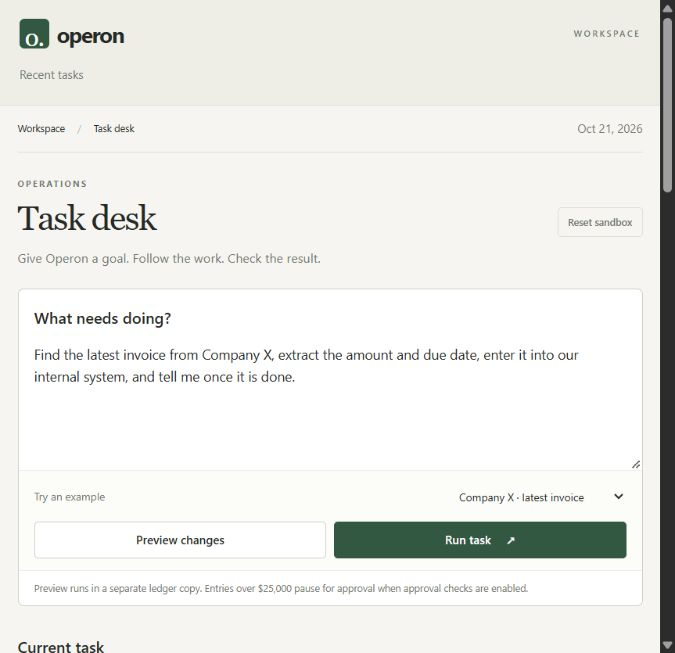

A preview report alongside the unchanged company ledger:

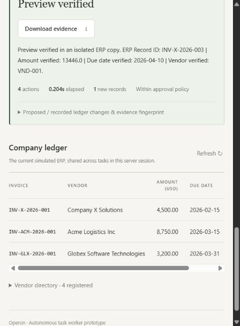

A high-value action paused before execution:

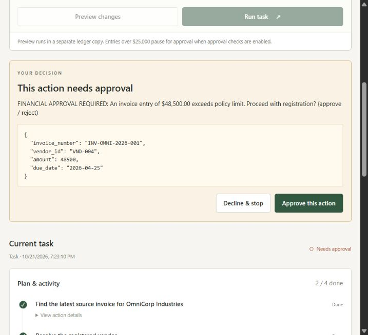

## Suggested next improvements

1. **Durable ERP plus durable checkpoints.** Persist both together so a paused task can safely resume after a restart. A report database alone is insufficient.
2. **A small held-out evaluation set.** Use unfamiliar synthetic vendors, missing fields, duplicate conflicts, changed sources, and transient failures. Report completion and false-success rates for offline and live planners separately.
3. **Conversational clarification.** Let a user supply a missing company or correct one ambiguous field while retaining the current plan and evidence.
4. **One real sandbox connector.** If needed, replace the ERP adapter with a permitted test API while preserving policy and verification. Add it only after the local demo remains reliable.

Scanned-document OCR, arbitrary desktop control, payment execution, multi-agent delegation, and multiple enterprise integrations remain outside this implementation. They would expand the prototype beyond the supplied brief's preference for narrow, genuine functionality.

## 22 October 2026 — Chat and scratchpad visual integration

Updated the newly added messaging and scratchpad components to match the task workspace.

- Removed the robot avatar, clipboard/pin/tag/flag emojis, dotted whiteboard background, colored sticky-note cards, shadows, and decorative status pills.
- Replaced them with neutral sections, simple borders, consistent typography, readable fact rows, and plain status labels.
- Simplified the labels to Task, Collected facts, Working notes, and Outcome.
- Styled the message area as a conversation with clearly labeled **You** and **Operon** turns.
- Bounded the conversation height with its own vertical scrollbar, so long requests and responses do not expand the entire page.
- Added keyboard focus and scrolling, plus a **Latest message** shortcut when viewing earlier content. Updates follow the latest response when already at the bottom and preserve the reading position otherwise.
- Kept the layout responsive: conversation labels and scratchpad sections stack on narrow screens, and summary statistics become simple rows.
- Changed **Copy notes** to export plain text with readable field/value pairs and an accessible copied/failure announcement.
- Clarified preview and incomplete statuses. Empty record counts now say **No new records** rather than implying a ledger match, and integrity text follows the actual verification result.

Files changed in this pass: `ui/static/index.html`, `ui/static/style.css`, `ui/static/app.js`, this report, and the two screenshots below. Backend execution, model configuration, source data, and the existing task workflows were retained.

Validation: JavaScript syntax and Git whitespace checks passed. Browser checks covered saved-task replay, populated scratchpad facts and notes, plain-text copying without emojis, and a longer request in an isolated preview. The long conversation overflowed within its bounded panel; Home scrolled to its beginning, and **Latest message** returned to the response. No browser console errors were recorded. This UI pass did not make live model calls.

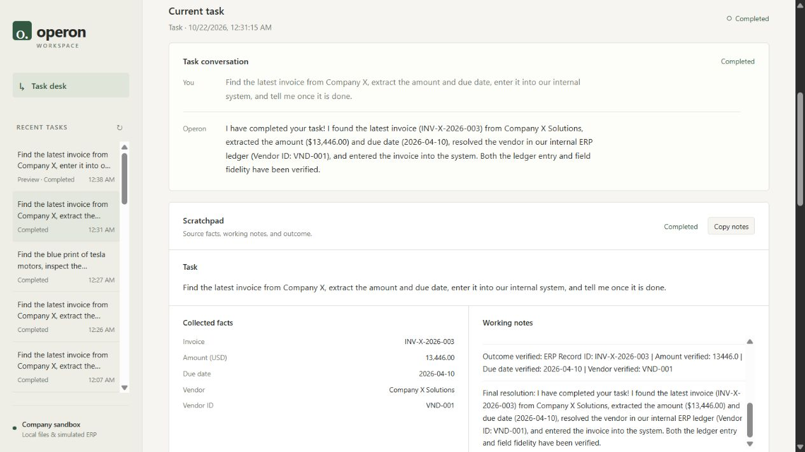

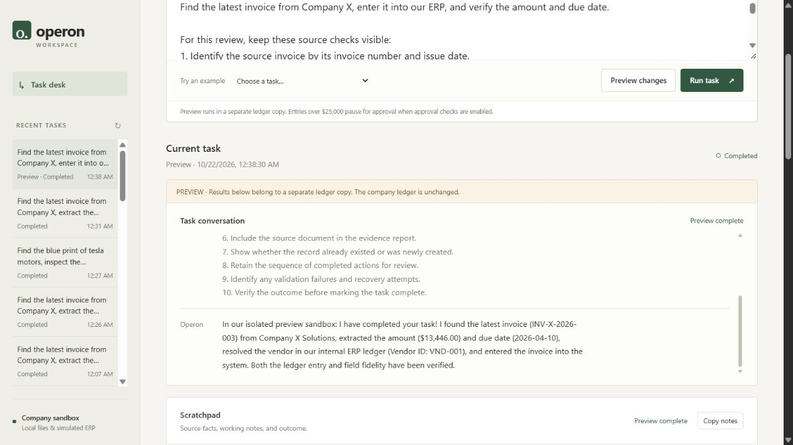

## 22 October 2026 — Conversation as the primary interface

Moved task entry into the conversation so Operon addresses the user directly and keeps requests, replies, and follow-up questions together.

- Added a **Send** composer beneath the scrollable transcript. Enter sends a message; Shift+Enter inserts a line. Examples and **Preview task** remain available beside Send.
- Added direct replies for greetings, help, and thanks without starting unnecessary jobs.
- Preserved earlier turns when a new task or question is sent. The latest 100 messages and the current task context survive reloads in the same browser.
- Added **New conversation** to clear the chat context while retaining the company ledger and saved task history.
- Answered common follow-ups about amounts, due dates, vendors, source documents, checks, and status from the saved evidence report. These questions do not rerun tools or infer values from a changed ledger. Failed results carry an explicit verification caveat, and incomplete records do not produce invented fields.
- Allowed **run it** after a verified preview to submit the same original goal for execution. **Preview task** always preserves preview mode, including for this follow-up.
- Allowed **approve** and **decline** as chat replies when an action is pending. Decisions reuse the existing action fingerprint and policy gate. A preview message cannot authorize an actual pending action.
- Positioned the restrained scratchpad beside the conversation, kept the composer visible below the messages, and collapsed detailed task activity and verification beneath the workspace.

The new `/api/chat` endpoint routes messages through `operon/conversation.py` and delegates work to the existing run manager. The agent graph, user-added live model planning, sample data, and task tools are retained. No extra model call is required for supported conversational replies.

Files changed in this pass: `operon/conversation.py`, `ui/app.py`, `ui/static/index.html`, `ui/static/app.js`, `ui/static/style.css`, `tests/test_conversation.py`, `README.md`, `ARCHITECTURE.md`, this report, and `docs/ui-conversation.png`.

Validation: **81 tests passed**, including 17 conversational cases covering social replies without jobs, grounded follow-ups, verified-preview execution, preview isolation, natural approval/decline, stale context, and incomplete failed observations. JavaScript syntax and Git whitespace checks passed. Browser validation covered greeting → invoice preview → follow-up question → reload with retained messages, plus a high-value task paused for approval and declined through the composer. No browser console errors were recorded. These checks used offline planning and synthetic company data; no paid model calls were made.

Limits: this is a task-scoped conversation with deterministic routing for supported follow-ups, not an unrestricted general chat model. It remembers the latest task context rather than resolving references across multiple old tasks. Editing a paused plan through missing-field clarification remains a proposed next improvement. Browser-local conversation storage is separate from SQLite task evidence and is not a synchronized chat archive.

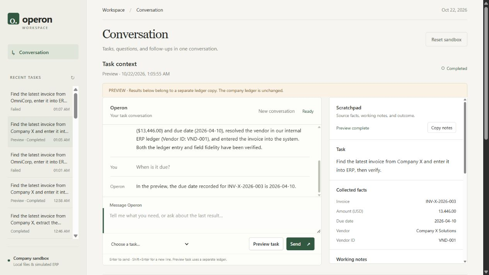

## 22 October 2026 — Useful failure replies and source-linked company tools

### Failure handling

- Added a structured issue to unsuccessful evidence reports: a reason code, readable status, direct explanation, and useful next step. Chat, task status, scratchpad, report, and history now distinguish a missing source, missing information, unsupported work, a declined action, invalid data, a conflict, a failed tool, and an unverified result.
- Removed internal verifier boilerplate from the primary reply. Detailed errors and checks remain in the evidence and expandable activity view.
- An empty required lookup now fails verification and stops dependent actions. An explicit alternate search can still recover; a later successful search clears the earlier empty-result state.
- A document read earlier in a task can no longer cause a success message after a later action fails. Partially applied ledger changes are disclosed, including the fact that they were not rolled back.
- Resource claims follow actual observations. An unsupported or unattempted lookup never says the resource does not exist. A missing local file is described within the checked workspace scope.
- Send **try again** after fixing a source to resubmit the previous goal through the normal planner, execution, and approval path. Failed previews retain preview mode. Questions such as **What went wrong?** explain the saved issue without creating another task.
- Final scratchpad notes now use the same deduplicating `add_note` method as other observations.
- Dashboard asset URLs include content hashes so a refresh loads changed JavaScript and CSS instead of retaining stale failure labels from an earlier version.

### Three additional working tools

| Tool | Actual work performed |
| --- | --- |
| `find_latest_signed_deal` | Reads company deal JSON files, excludes drafts/cancelled deals, compares actual signing dates, optionally filters a customer, and captures a catalogue manifest. Equal latest dates require clarification. |
| `read_deal_quotation` | Follows the selected signed deal's explicit quotation link, reads the local quotation, and checks IDs, customer, amount, and currency. A missing link never falls back to an unrelated quotation. |
| `search_company_records` | Searches text/JSON/Markdown/CSV document contents, ERP invoice snapshots, and vendor records together. Returns typed matches, excerpts, source hashes, an explicit result limit, and skipped-file warnings. |

These tools work in the offline planner and are available to the optional live planner. They are read-only and allowed in previews. Existing invoice, onboarding, approval, and user-added tool capabilities were retained.

### Novelty: verify the relationship and selection, not just the file

The quotation workflow checks more than whether a document can be opened. Independent verification rereads the deal catalogue, checks its selection manifest, confirms the latest signed date, excludes unsigned deals, and verifies that the quotation belongs to that exact deal with matching fields. Source changes invalidate the result. Cross-source search similarly checks captured document hashes and current ledger snapshots.

The scratchpad now includes **Source files** links. The source endpoint accepts only indices into a run's captured sandbox sources and checks the current file hash against the evidence before serving it as plain text. A changed source returns a clear conflict instead of displaying new content as if it were the captured evidence.

Added synthetic company data: four deals and three quotation files. Acme is the latest signed deal; Company X has an unsigned draft excluded from selection. OmniCorp has a signed deal whose linked quotation is intentionally absent, giving the demo a real missing-resource case. No CRM connection, quotation sending, payment, or real company data is involved.

### Demo requests

1. **Get me the quotation for the latest deal signed.** Returns Acme quotation `QT-2026-105`, USD 24,000.00, linked to deal `DEAL-2026-105`, signed 2026-10-20. Open both source links and expand the independent checks.
2. **Get the quotation for the latest signed deal with OmniCorp.** Finds the deal, explains that its linked quotation is unavailable, gives a correction step, and reports an unfinished task. It creates no ledger records.
3. **Search company records for Acme.** Returns document, invoice, and vendor matches through the same graph.
4. After correcting a missing source in the workspace, send **try again**. The worker retries the original goal, verifies the newly available source, and retains the original preview/execute mode.

### Validation and limits

- **108 tests passed** with offline planning, including latest-date selection, missing customers/quotations, ambiguity, malformed sources, mismatched tool output, catalogue changes, path confinement, combined search, incomplete searches, corrected-source retry, and source-view hash/scope checks.
- JavaScript syntax and Git whitespace checks passed.
- Browser checks verified the exact quotation request from the reported failure, populated deal/quotation facts, a working source link opening the actual quotation, a missing linked quotation with a direct explanation and next step, and no console errors. Initial checks used a separate offline server and synthetic data. The normal configured app was also exercised: its Groq request was unavailable, so both quotation checks completed through the disclosed offline fallback. Live model planning was not confirmed by this validation.
- The Python wheel built offline using the available system build tools; its archive includes all four deal sources and three quotation files. The project virtual environment did not contain setuptools, so the packaging check used the already-installed system setuptools without installing dependencies.

Quotation sources use local JSON, USD sample values, and signing dates with day precision. Company search is bounded keyword matching rather than semantic retrieval. Source hashes detect changes relative to a report; they do not prove authorship. Chat still uses the latest task context and does not edit paused plans through arbitrary dialogue. Durable ledger/checkpoint persistence and broader held-out task evaluation remain the highest-value next steps.

Files changed in this pass include `operon/outcomes.py`, `operon/company_verification.py`, `operon/tools/company_tools.py`, the deal/quotation sample directories, tool registration and planning, scratchpad memory, observer/replanner/verifier/summarizer, evidence models and run history, the source API, conversation handling, UI files, packaging, regression tests, and the README/architecture documents.

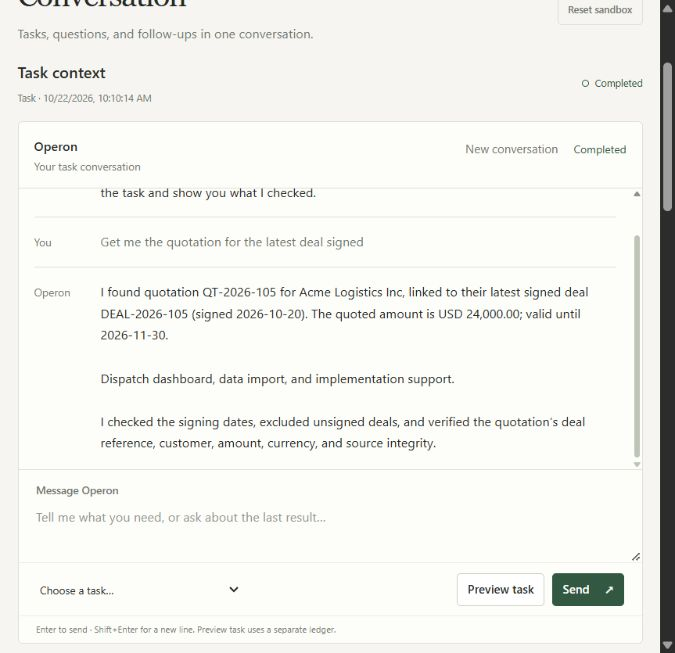

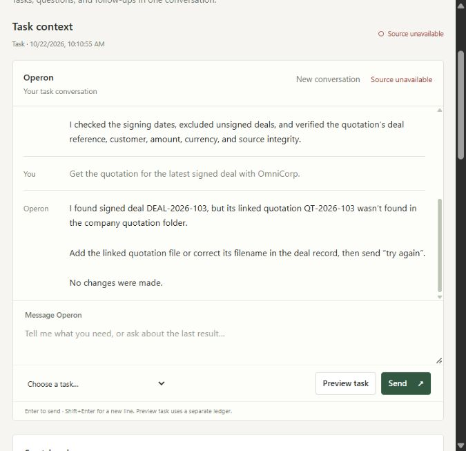

## 22 October 2026 — Open evidence and friendlier task replies

Made the conversation and evidence easier to read during an active task or demo.

- Kept action details, task activity, verification, report evidence, vendor records, and every plan step expanded. Their disclosure arrows remain open and the sections do not collapse when clicked, so tool arguments and checks are always available for inspection.
- Gave Operon messages a quiet green response surface with a left accent, while leaving user messages visually lighter. This separates the worker’s answer from the request without adding an avatar, emoji, gradient, or oversized chat bubble.
- Highlighted the scratchpad outcome with a green verified treatment and a muted red attention treatment. The factual response and status remain readable as one result block.
- Rewrote greetings, progress updates, approval prompts, help text, and common conversational replies in a warmer, direct voice. Final invoice, vendor, quotation, and document messages now lead with the useful result while retaining the same source and verification claims.
- Added a dashboard regression check for permanently expanded disclosures and updated the README and architecture notes to describe the behavior.

Files changed in this pass: `ui/static/index.html`, `ui/static/app.js`, `ui/static/style.css`, `operon/conversation.py`, `operon/nodes/summarizer.py`, `tests/test_dashboard.py`, `README.md`, `ARCHITECTURE.md`, and this report.

Validation: **108 tests passed**. JavaScript syntax and Git whitespace checks passed. A live browser run completed the latest-signed-deal quotation workflow and showed the new conversational answer, highlighted verified outcome, and permanently expanded activity, tool arguments, report evidence, and vendor records. The running app disclosed its offline planner fallback because Groq was unavailable.

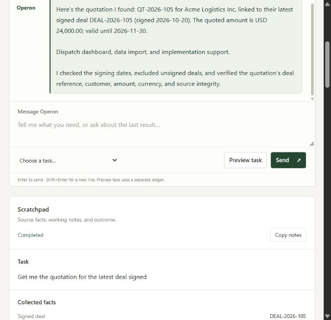

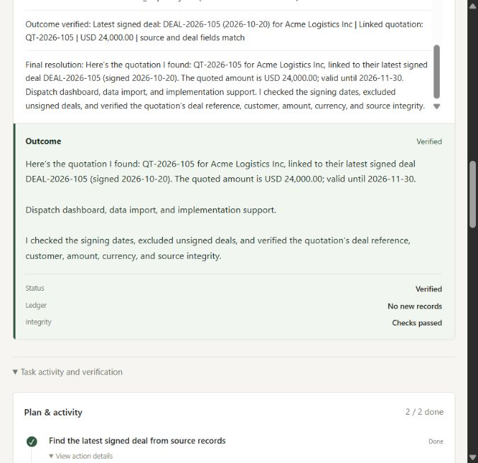

## 22 October 2026 — Data-aware approvals and clearable history

Extended the exact-action approval gate into a resource-aware policy system and added deliberate cleanup for saved tasks and conversations.

### Sensitive-resource policy

- Added `operon/safety/data_policy.py` with four classifications: **PUBLIC**, **INTERNAL**, **CONFIDENTIAL**, and **RESTRICTED**.
- Classified vendor onboarding profiles as restricted because they contain tax identifiers and business contact details. Invoice, deal, quotation, and blueprint sources are confidential; ordinary sandbox documents default to internal. Conservative filename hints catch credential, payroll, employee, banking, tax-ID, contract, invoice, and similar resources outside the standard folders.
- Evaluated policy after scratchpad interpolation so the gate sees the actual file path and resolved action arguments.
- Required approval for restricted reads in both preview and execute modes. Preview still bypasses approvals that protect only real writes because it uses an isolated ledger, but it no longer treats data exposure as harmless.
- Required a separate execution approval before storing vendor tax/contact details, writing persistent files, submitting browser forms, mutating APIs, or calling APIs with credential-bearing headers. Existing destructive-tool and $25,000 financial thresholds remain active.
- Versioned action fingerprints with the policy version. One approval authorizes one exact step, tool, and original argument set; the next protected action is evaluated independently.
- Redacted credentials, request bodies, full tax identifiers, and email local parts from the approval display while retaining the original values inside the checkpoint for execution and hashing.
- Recorded policy ID, risk, classification, resource, categories, approval scope, action fingerprint, and final decision (`approved`, `declined`, or `would_require_on_execution`) in the evidence packet.
- Added classification and categories to captured source-document evidence. Restricted source downloads require a matching recorded approval as well as the existing hash and sandbox-scope checks.

### File and action restrictions

- Confined file reads and searches to company sample data and run storage.
- Confined writes to run storage or the operating-system temporary directory. Relative output paths now resolve under run storage.
- Kept the bounded planner unchanged: arbitrary APIs, browser submission, deletion, and file writes are still unavailable to offline task planning. The strengthened policy protects those registered tools if a live plan proposes them.

### Approval interface

- Replaced the generic interrupt text with an approval card that identifies risk, classification, resource, policy reason, and whether the rule also applies to previews.
- Renamed the positive action to **Approve once** and kept the exact redacted arguments visible. Approval details remain expanded with the rest of the task evidence.
- Improved report policy summaries to distinguish protected actions identified in previews from approved or declined actions in executions.

### History and conversation cleanup

- Added **Clear** beside Recent tasks. The first click arms **Confirm clear** for five seconds; the second deletes saved SQLite reports and event streams and starts a fresh browser conversation.
- Blocked history deletion while a task is running or waiting for approval. Clearing history does not reset the simulated ERP.
- Retained **New conversation** for clearing only the current browser conversation while keeping saved task history.

Validation: **118 tests passed**. New coverage checks classification, preview-sensitive approval, consecutive exact-action approvals, redacted arguments, file confinement, restricted source access, approval evidence, idle history deletion, and active-run deletion blocking. JavaScript syntax and Git whitespace checks passed.

Files changed in this pass: `operon/safety/data_policy.py`, `operon/safety/approval.py`, `operon/tools/file_tools.py`, `operon/nodes/executor.py`, `operon/graph.py`, `operon/agent.py`, `operon/state.py`, `operon/memory/scratchpad.py`, `operon/runs.py`, `ui/app.py`, `ui/static/index.html`, `ui/static/app.js`, `ui/static/style.css`, `tests/test_data_policy.py`, `tests/test_dashboard.py`, `tests/test_workflows.py`, `tests/test_end_to_end.py`, `README.md`, `ARCHITECTURE.md`, and this report.

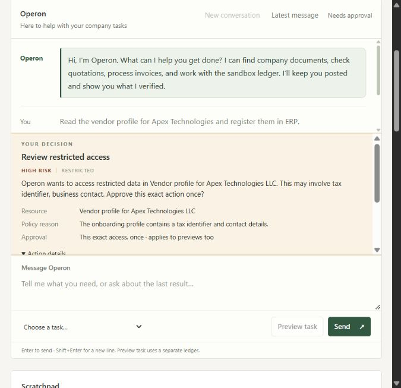

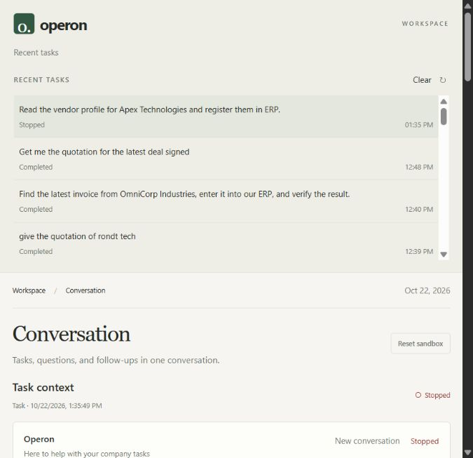
